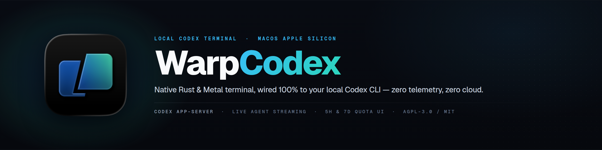

# WarpCodex – Local-first macOS Warp terminal powered by Codex

[](https://github.com/luka-loehr/warp-codex/releases)
[](https://github.com/luka-loehr/warp-codex/releases)
[](app/src/ai/codex_local)
[](https://github.com/openai/codex)
[](#license)

**WarpCodex** is a local-first macOS build of the open-source [Warp terminal](https://github.com/warpdotdev/warp) where every AI feature runs directly on your Mac through your installed [Codex CLI](https://github.com/openai/codex) (`codex app-server` over stdio JSON-RPC 2.0). No Warp account, no cloud sync, no RudderStack telemetry, and no Sentry crash uploads.

---

## Features

- **Full Agent Mode streaming** — Live token-by-token output, extended reasoning blocks, shell command execution, file diffs, MCP tool calls, web search, and live todo checklists over persistent `codex app-server` threads
- **Native Plan mode** — Warp collaboration plan mode wired directly to Codex `collaborationMode: "plan"`
- **Complete Warp AI parity** — `#` natural-language command search, AI assistant panel, workflow generation, next-command and error-fix suggestions, `@` relevant-file ranking, shared block titles, and Git code review
- **Dynamic models and reasoning efforts** — Pulls `model/list` live from your ChatGPT Plus, Pro, or Team plan (or API key) with `Low`, `Medium`, `High`, `Extra High`, `Max`, and `Ultra` effort tiers in Warp's model picker
- **5-hour and 7-day quota UI** — Shows your plan badge, rolling 5-hour and 7-day rate-limit bars, reset countdowns, lifetime token stats, and one-click ChatGPT OAuth sign-in / sign-out in the footer usage popover and **Settings → Codex & Usage**
- **Zero telemetry and zero login wall** — Strips RudderStack analytics, Sentry crash reporting, Firebase auth, cloud preference syncing, and background auto-updaters; opens straight into your local shell

---

## Quick start

1. Install the official OpenAI Codex CLI on macOS and sign in once:
   ```bash
   brew install codex
   codex login
   ```
2. Download **`WarpCodex-macos-arm64.dmg`** from [GitHub Releases](https://github.com/luka-loehr/warp-codex/releases/latest) and drag **`WarpCodex.app`** into `/Applications`.
3. Clear macOS Gatekeeper quarantine on the ad-hoc signed bundle before first launch:
   ```bash
   xattr -cr /Applications/WarpCodex.app
   ```
4. Open **WarpCodex** — your terminal, models, and Codex quota bars connect automatically. If `codex` lives in a custom path, set `WARP_CODEX_BIN=/path/to/codex`.

---

## Documentation

- [Architecture & Building from Source](docs/ARCHITECTURE.md) — `codex app-server` JSON-RPC 2.0 bridge, telemetry stripping, and local `.app` / `.dmg` build instructions
- [Local Codex Adapter (`app/src/ai/codex_local`)](app/src/ai/codex_local) — Rust RPC client, multi-agent event translator, and native usage UI
- [Releases](https://github.com/luka-loehr/warp-codex/releases) — Prebuilt macOS Apple Silicon (`arm64`) `.dmg`, `.app.zip`, and SHA-256 checksums

---

## License

`WarpCodex` is a derivative work of [`warpdotdev/warp`](https://github.com/warpdotdev/warp) and preserves upstream licensing:
- Core terminal & application crates (`app/`, `crates/`): [GNU Affero General Public License v3.0 (AGPL-3.0)](LICENSE-AGPL)
- UI framework crates (`warpui/`): [MIT License](LICENSE-MIT)

---

## Support

- [Report bugs](https://github.com/luka-loehr/warp-codex/issues)
- [luka@lukaloehr.com](mailto:luka@lukaloehr.com)

---

Developed by [Luka Löhr](https://github.com/luka-loehr)
